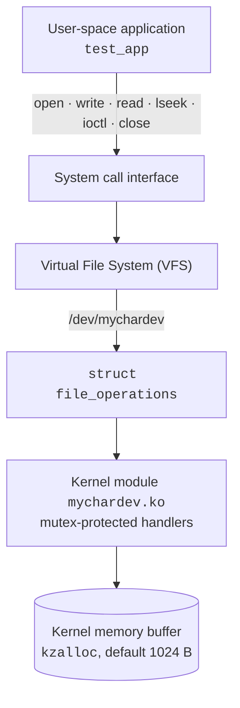
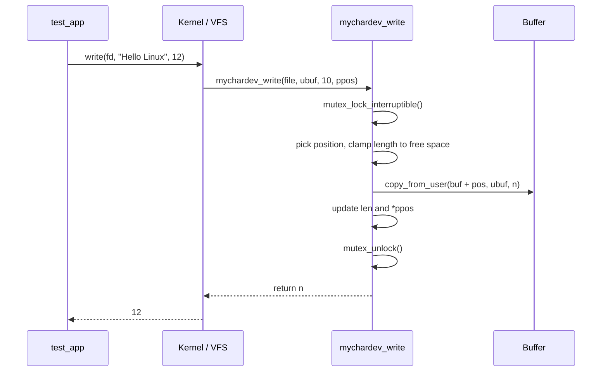

<div align="center">

# 🐧 Linux Character Device Driver with `ioctl` Support

**A virtual character device, written as a Linux kernel module, that lets a normal C program talk to the kernel through `open`, `read`, `write`, `lseek` and `ioctl`.**


[Overview](#-overview) •
[Features](#-features) •
[Architecture](#-architecture) •
[Quick start](#-quick-start) •
[ioctl API](#-ioctl-api) •
[Testing](#-testing) •
[Design notes](#-design-decisions) •
[Troubleshooting](#-troubleshooting)

</div>

---

## 📖 Overview

On Linux, applications reach devices such as keyboards, disks and sensors through **device drivers**. A driver runs inside the kernel and exposes the device as a file under `/dev`, so ordinary programs can use the same system calls they use for files.

This project builds a **virtual character device**, `/dev/mychardev`. No physical hardware is involved: the driver simply manages a buffer in kernel memory. A user-space program can:

- **write** a message into the buffer,
- **read** it back,
- **seek** within it,
- send **`ioctl`** commands for operations that are not plain reads or writes (clear the buffer, query its length and capacity).

```text
$ ./test_app
Device opened successfully
Writing: Hello Linux
Bytes written: 12
Reading from device: Hello Linux
Sending command: CLEAR_BUFFER
Buffer cleared successfully
Closing device
```

> The 12 bytes are the 11 characters of `Hello Linux` plus the terminating NUL byte.

### What you will learn from it

| Area | Where it shows up |
|------|-------------------|
| Kernel modules | `module_init` / `module_exit`, module parameters, `MODULE_*` metadata |
| Character devices | `alloc_chrdev_region`, `cdev_add`, `class_create`, `device_create` |
| User ↔ kernel boundary | `copy_to_user`, `copy_from_user`, `put_user`, `EFAULT` handling |
| System calls | How `read()` / `write()` / `ioctl()` reach a driver through `struct file_operations` |
| Memory safety | Bounds checks, partial reads/writes, overflow-safe `lseek` |
| Concurrency | Mutex-protected shared buffer, interruptible locking |
| Error handling | Proper `errno` values, `goto`-based cleanup in `init` |
| Testing | Automated suite with failure cases and a multi-threaded race test |

---

## ✨ Features

- ✅ Dynamic major/minor allocation and **automatic `/dev/mychardev` creation** (no `mknod`)
- ✅ `read()`, `write()`, `lseek()`, `open()`, `release()` and `unlocked_ioctl()`
- ✅ **Bounded buffer**, 1 024 bytes by default, configurable at load time (`buffer_size=…`)
- ✅ **Partial reads and writes** handled correctly, `ENOSPC` when the buffer is full
- ✅ **`O_APPEND`** support
- ✅ Three `ioctl` commands; unknown or foreign commands rejected with `ENOTTY`
- ✅ **Mutex-protected** buffer, safe under concurrent access
- ✅ Safe user-space access, bad pointers return `EFAULT` instead of crashing
- ✅ Clean error unwinding on load failure and clean teardown on unload
- ✅ Demo program **and** an automated test suite (including a multi-threaded race test)
- ✅ Version guards for kernel API changes (`class_create` in 6.4, `devnode` in 6.2)

---

## 🏗 Architecture

### Layers



### What happens on a `write()`



### Project structure

```text
Linux-Character-Device-Driver-with-ioctl-Support/
├── mychardev.c            # Kernel module: device registration + file operations
├── mychardev.h            # ioctl numbers shared by kernel and user space
├── test_app.c             # Demo program and automated test suite
├── Makefile               # kbuild for the module, gcc for the app
├── README.md
├── .gitignore
└── tests/
    ├── run_tests.sh       # build → load → test → unload → dmesg
    └── test_cases.md      # test plan
```

### Module lifecycle

| Step | `mychardev_init` (on `insmod`) | Undone by `mychardev_exit` (on `rmmod`) |
|------|-------------------------------|------------------------------------------|
| 1 | Validate `buffer_size` | |
| 2 | `kzalloc` the device struct and buffer | `kfree` buffer and struct |
| 3 | `alloc_chrdev_region` (get major/minor) | `unregister_chrdev_region` |
| 4 | `cdev_init` + `cdev_add` (register fops) | `cdev_del` |
| 5 | `class_create` | `class_destroy` |
| 6 | `device_create` (udev makes `/dev/mychardev`) | `device_destroy` |

If any step fails, `init` jumps to a `goto` label that releases only what was already acquired, in reverse order.

---

## 🚀 Quick start

### Prerequisites

Use an **Ubuntu virtual machine**. A kernel bug can crash the whole operating system, so do not experiment on your main machine.

```bash
sudo apt update
sudo apt install build-essential linux-headers-$(uname -r) git
```

### Get the code

```bash
git clone https://github.com/<your-username>/Linux-Character-Device-Driver-with-ioctl-Support.git
cd Linux-Character-Device-Driver-with-ioctl-Support
```

### Build, load, run, unload

```bash
make                  # builds mychardev.ko and test_app
sudo make load        # insmod; /dev/mychardev appears
./test_app            # run the demo
./test_app --test     # run the automated tests
dmesg | tail          # see kernel log messages
sudo make unload      # rmmod
```

One command that does everything (build, load, test, unload, show `dmesg`):

```bash
sudo ./tests/run_tests.sh
```

### Makefile targets

| Command | What it does |
|---------|--------------|
| `make` | Build the kernel module and the test app |
| `sudo make load` | `insmod mychardev.ko` and show the last kernel messages |
| `make demo` | Run `./test_app` |
| `make test` | Run `./test_app --test` |
| `sudo make unload` | `rmmod mychardev` |
| `make clean` | Remove build artefacts |

### Module parameter

| Parameter | Default | Range | Example |
|-----------|---------|-------|---------|
| `buffer_size` | `1024` | `1 – 65536` | `sudo insmod mychardev.ko buffer_size=4096` |

An out-of-range value makes `insmod` fail with `Invalid argument`.

---

## 🎛 Behaviour reference

| Operation | What the driver does | Errors |
|-----------|---------------------|--------|
| `open()` | Stores the device pointer in `file->private_data` | none |
| `write()` | Copies data into the buffer at the file offset (or at the end of the data with `O_APPEND`). **Truncates** to the space left, so the return value can be smaller than requested. | `ENOSPC` buffer full · `EFAULT` bad pointer · `ERESTARTSYS` interrupted |
| `read()` | Copies up to `count` bytes from the file offset. Returns fewer bytes near the end, and `0` at end of data or when the buffer is empty. | `EFAULT` bad pointer · `ERESTARTSYS` interrupted |
| `lseek()` | Moves the offset (`SEEK_SET`, `SEEK_CUR`, `SEEK_END`) within `[0, capacity]` | `EINVAL` out of range or bad `whence` |
| `ioctl()` | See [ioctl API](#-ioctl-api) | `ENOTTY` unknown command · `EFAULT` bad pointer |
| `release()` | Nothing to clean up per file; logs at debug level | none |

> ⚠️ **Overwrite semantics.** Writes start at the current offset and overwrite existing bytes. If you write a shorter message over a longer one, the tail of the old message remains. Call `MYCHARDEV_CLEAR_BUFFER` first when you want a fresh message.

### Trying it from the shell

```bash
sudo insmod mychardev.ko
echo -n "hello" > /dev/mychardev
cat /dev/mychardev                    # hello

echo -n "yo" > /dev/mychardev         # overwrites from offset 0
cat /dev/mychardev                    # yollo   (old tail remains)
```

---

## 🔌 ioctl API

Defined in [`mychardev.h`](mychardev.h), which is shared by the driver and the app so both always agree on the command encoding.

| Command | Macro | Direction | Argument | Result |
|---------|-------|-----------|----------|--------|
| Clear buffer | `MYCHARDEV_CLEAR_BUFFER` | none (`_IO`) | none | Zeroes the buffer, length becomes 0 |
| Get length | `MYCHARDEV_GET_LENGTH` | read (`_IOR`) | `unsigned int *` | Number of valid bytes stored |
| Get capacity | `MYCHARDEV_GET_CAPACITY` | read (`_IOR`) | `unsigned int *` | Total buffer size in bytes |

Magic number: `'k'`. Any command with a different magic number, or a number above `MYCHARDEV_IOC_MAXNR`, returns `-ENOTTY`.

### Example

```c
#include <fcntl.h>
#include <stdio.h>
#include <string.h>
#include <unistd.h>
#include "mychardev.h"

int main(void)
{
    int fd = open("/dev/mychardev", O_RDWR);
    unsigned int len, cap;
    char buf[64] = {0};

    ioctl(fd, MYCHARDEV_CLEAR_BUFFER);
    write(fd, "Hello Linux", 12);

    ioctl(fd, MYCHARDEV_GET_LENGTH, &len);
    ioctl(fd, MYCHARDEV_GET_CAPACITY, &cap);
    printf("%u of %u bytes used\n", len, cap);    /* 12 of 1024 bytes used */

    lseek(fd, 0, SEEK_SET);                       /* rewind before reading */
    read(fd, buf, sizeof(buf) - 1);
    printf("%s\n", buf);

    close(fd);
    return 0;
}
```

---

## 🧪 Testing

Run everything with:

```bash
sudo ./tests/run_tests.sh
```

or, with the module already loaded, `./test_app --test`. The exit code is `0` only if every check passes.

### Test groups

| Group | What is verified |
|-------|------------------|
| Basic round trip | `open`, write returns 12, `GET_LENGTH`, `lseek`, read-back data matches, EOF returns 0 |
| Empty buffer and clear | `CLEAR_BUFFER`, `GET_LENGTH == 0`, read on empty buffer returns 0, zero-length write |
| Partial reads | 10 bytes read as 4 + 4 + 2, then EOF |
| Capacity limits | `GET_CAPACITY`, oversized write truncated to capacity, `ENOSPC` when full |
| `lseek` and `O_APPEND` | `SEEK_END`, out-of-range and negative offsets give `EINVAL`, append lands after existing data |
| Error handling | Wrong ioctl magic and unknown number give `ENOTTY`; bad pointers give `EFAULT` for `ioctl`, `read` and `write` |
| Concurrency | 4 threads × 20 000 `pwrite`/`pread` of 64-byte uniform blocks; every block read back must be uniform (no torn data) |

The full scenario table is in [`tests/test_cases.md`](tests/test_cases.md).

### Does the race test actually catch races?

Yes, you can prove it. Temporarily comment out the `mutex_lock_interruptible` / `mutex_unlock` calls in `mychardev_read` and `mychardev_write`, rebuild, reload and run the tests. The concurrency group should start failing. Restore the locks afterwards.

### Test results

Add your own evidence here after running the suite in your VM:

```text
$ uname -r
<your kernel version>

$ sudo ./tests/run_tests.sh
<paste the output here>
```

---

## 🧠 Design decisions

<details>
<summary><b>Why <code>copy_to_user</code> / <code>copy_from_user</code> instead of <code>memcpy</code>?</b></summary>

User-space pointers can be invalid, unmapped or malicious, and the kernel must never trust them. These helpers validate the access and report failure, which the driver turns into `-EFAULT`. Using `memcpy` on a user pointer can oops the kernel or open a security hole.
</details>

<details>
<summary><b>Why a mutex and not a spinlock?</b></summary>

Copying to or from user space can **sleep** (for example on a page fault). Sleeping while holding a spinlock is forbidden. A mutex is allowed to sleep, so it is the right tool here.
</details>

<details>
<summary><b>Why <code>mutex_lock_interruptible</code>?</b></summary>

If another task holds the lock for a long time, a waiting process can still be killed by a signal rather than being stuck uninterruptibly. The handler returns `-ERESTARTSYS` in that case.
</details>

<details>
<summary><b>Why does an unknown <code>ioctl</code> return <code>ENOTTY</code>?</b></summary>

`ENOTTY` ("inappropriate ioctl for device") is the conventional errno for an unsupported ioctl command. The driver also checks `_IOC_TYPE` and `_IOC_NR` first so foreign commands are rejected before any work is done.
</details>

<details>
<summary><b>Why does <code>lseek</code> reject large offsets up front?</b></summary>

Checking `off` against `±capacity` before doing arithmetic guarantees `file->f_pos + off` and `len + off` can never overflow.
</details>

<details>
<summary><b>Why keep bytes past <code>len</code> zeroed?</b></summary>

`lseek` can move the offset past the end of the stored data (up to capacity). A later write there creates a gap, and the invariant "everything past `len` is zero" means the gap reads back as zeros instead of stale or uninitialised data. `CLEAR_BUFFER` zeroes the whole buffer, and a failed `copy_from_user` zeroes whatever it may have partially written beyond `len`.
</details>

<details>
<summary><b>Why the goto-based cleanup in <code>init</code>?</b></summary>

Each registration step can fail. Labelled `goto`s release exactly what was acquired so far, in reverse order. This is a standard kernel idiom and avoids deeply nested `if`s and leaks.
</details>

<details>
<summary><b>Why is the device mode 0666?</b></summary>

So the demo and tests run without `sudo`. The class's `devnode` callback sets the mode when udev creates the node. For anything beyond a learning project, restrict it (for example 0660 with a dedicated group).
</details>

---

## 🛠 Troubleshooting

| Symptom | Likely cause and fix |
|---------|----------------------|
| `make: *** /lib/modules/.../build: No such file or directory` | Kernel headers missing. Run `sudo apt install linux-headers-$(uname -r)`. |
| `insmod: ERROR: could not insert module ... Key was rejected by service` | Secure Boot blocks unsigned modules. Disable Secure Boot in the VM, or sign the module with a MOK key. |
| `insmod: ... Invalid argument` | `buffer_size` outside 1–65536, or check `dmesg` for the reason. |
| `insmod: ... File exists` | The module is already loaded. Run `sudo rmmod mychardev` first. |
| `open(/dev/mychardev): No such file or directory` | Module not loaded, or udev has not created the node yet. Check `lsmod \| grep mychardev` and `ls -l /dev/mychardev`. |
| `open(/dev/mychardev): Permission denied` | Node was created with different permissions. Re-load the module, or use `sudo`. |
| Compile errors about `class_create` or `devnode` | Your kernel's API differs from the guarded versions. Check `uname -r` and open an issue with the error text. |
| `rmmod: ERROR: Module mychardev is in use` | Some process still has `/dev/mychardev` open. Close it and retry. |

Useful commands while debugging:

```bash
dmesg | tail -n 20            # kernel messages from the driver
lsmod | grep mychardev        # is it loaded?
ls -l /dev/mychardev          # node and permissions
cat /proc/devices | grep mychardev   # major number
modinfo ./mychardev.ko        # module metadata and parameters
```

---

## 🗺 Roadmap and ideas to extend

- [ ] `poll()` / blocking reads with a wait queue
- [ ] Ring buffer instead of a flat buffer
- [ ] Statistics in `/proc` or `sysfs` (bytes read, bytes written)
- [ ] Multiple device instances (more than one minor number)
- [ ] `SET_CAPACITY` ioctl
- [ ] Run with KASAN and lockdep enabled to look for memory and locking bugs
- [ ] Platform-driver / Device Tree version
- [ ] GitHub Actions workflow that builds the module and the test app

---

## ⚠️ Limitations

This is a **learning project**. It is a practical foundation, not proof of expertise in Linux kernel internals, processor architecture, virtualization or upstream kernel development. The device is world-readable and writable (0666) for convenience, and it has only been exercised on the kernels you test it on, so record your own results in the [Test results](#test-results) section.

---

## 📚 References

- [Linux kernel driver API documentation](https://www.kernel.org/doc/html/latest/driver-api/)
- [How to participate in Linux kernel development](https://www.kernel.org/doc/html/latest/process/howto.html)
- [ioctl numbers](https://www.kernel.org/doc/html/latest/userspace-api/ioctl/ioctl-number.html)

---

## 📄 License

Released under the **GPL-2.0** license. A kernel module that uses GPL-only kernel symbols must declare a GPL-compatible license.

<div align="center">

⭐ If this project helped you, consider giving it a star.

</div>
